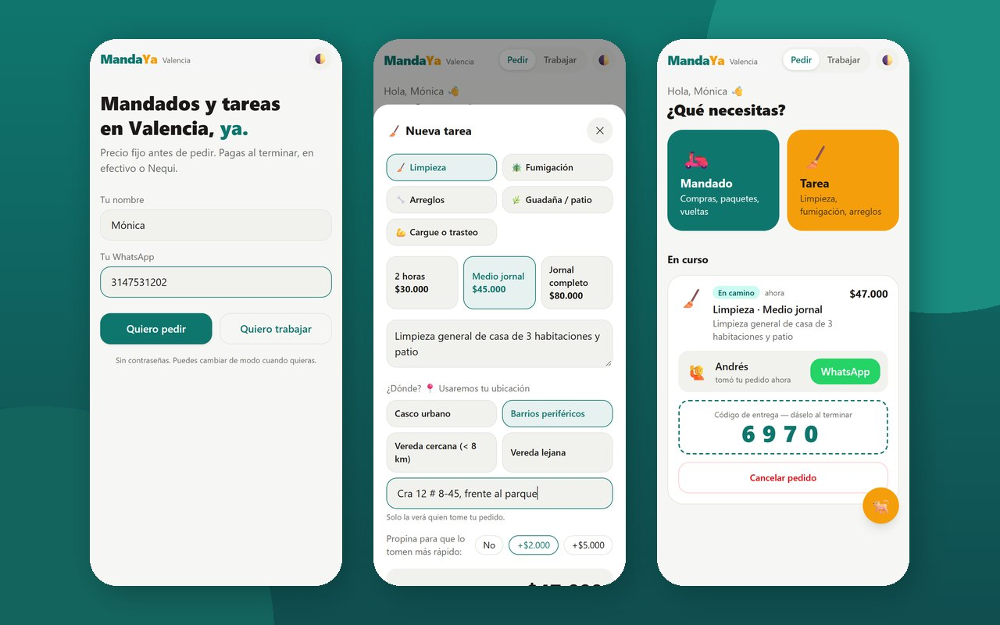
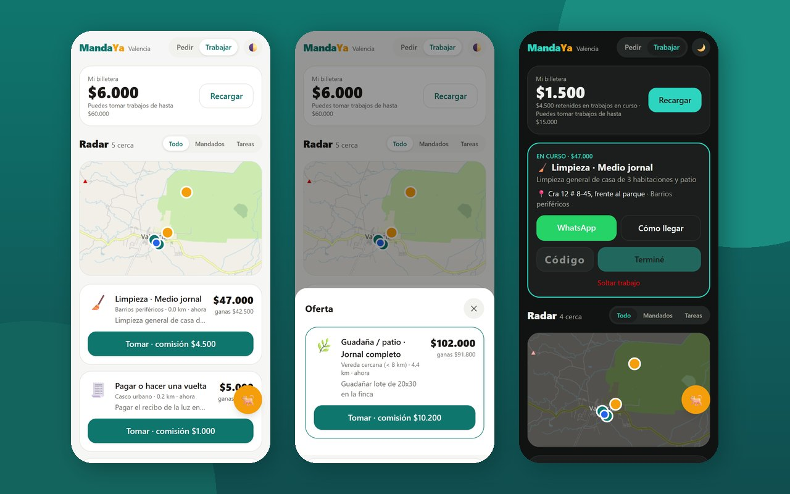
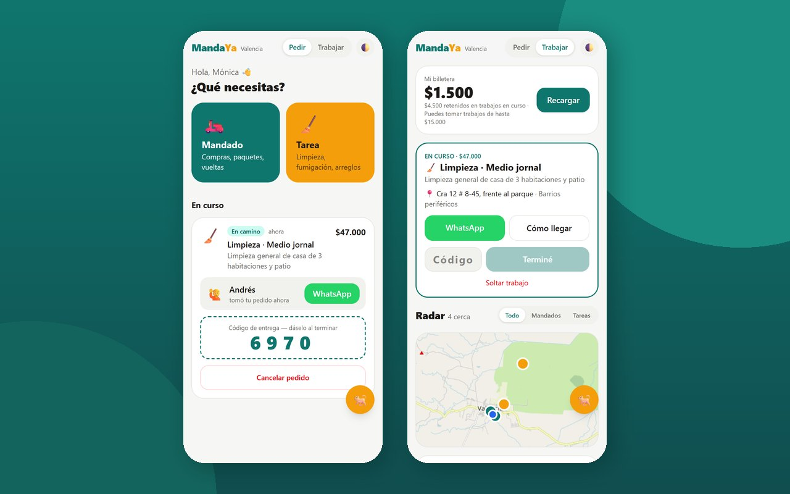
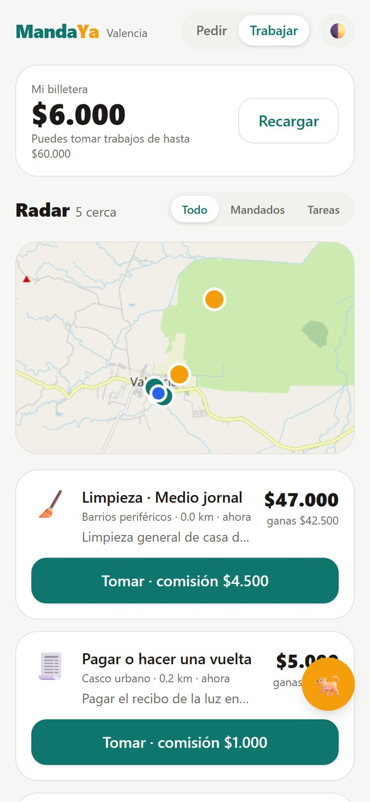

<p align="center">
  
</p>

<h1 align="center">MandaYa Valencia</h1>
<p align="center"><b>Mandados y tareas de la vida diaria, resueltos por gente del mismo municipio</b><br>
Caso de éxito de <a href="https://github.com/macsaenz07">MyS SinergiaaS</a> · en producción</p>

<p align="center">
  <a href="https://mandaya-valencia.vercel.app"></a>
  
  
</p>

---

## El encargo

En un municipio como Valencia (Córdoba), quien necesita que le traigan algo de la plaza, le
fumiguen la casa o le guadañen el patio pregunta en el barrio o en un grupo de WhatsApp: no sabe
cuánto va a costar, quién va a llegar ni si de verdad llegará. Del otro lado, mucha gente
dispuesta a trabajar se entera tarde de esos trabajos, o no se entera.

## Lo que entregamos

Una plataforma de economía colaborativa hiperlocal con dos modos en la misma app: **pedir** y
**trabajar**.

| Resultado | Qué significa para el usuario |
|---|---|
| **Precio fijo antes de pedir** | El cliente ve el valor exacto antes de confirmar. Nada de regateo ni sorpresas. |
| **Radar en vivo** | El trabajador ve en un mapa las ofertas cercanas, cuánto gana neto y lo que debe adelantar. |
| **Pago directo** | El cliente le paga al trabajador al terminar, en efectivo o por Nequi. La plataforma no retiene su plata. |
| **Comisión justa** | El trabajador solo paga comisión por los trabajos que termina. Si suelta uno o el cliente cancela, se le devuelve. |
| **Código de entrega** | Para cerrar el trabajo, el cliente le da al trabajador un código de 4 dígitos cuando todo está hecho. |
| **Bono de bienvenida** | Quien llega a trabajar empieza con saldo para sus primeros trabajos. |

## Experiencia de usuario

- **Cero contraseñas.** Nombre y WhatsApp, y adentro. Se cambia entre «Pedir» y «Trabajar» con un toque.
- **Tres toques para pedir:** qué necesitas, dónde y confirmar. La propina opcional ayuda a que lo tomen más rápido.
- **Privacidad por defecto.** El radar muestra la zona; el teléfono y la dirección exacta solo los ve
  quien tomó el trabajo.
- **Everest, el guía de MyS SinergiaaS**, explica cada pantalla, busca lo que la persona quiere hacer
  y, si algo falla, propone el siguiente paso con un botón que lo resuelve.
- **Tema claro, oscuro o automático**, e instalable en el celular como una aplicación.

## Capturas

| Pedir | Radar del trabajador | Entrega |
|---|---|---|
|  |  |  |

<p align="center"></p>

## Stack tecnológico aplicado

| Capa | Tecnología |
|---|---|
| Interfaz | React 19 · Vite · **Tailwind CSS 4** · diseño pensado primero para el celular |
| Aplicación instalable | PWA con manifiesto e íconos propios |
| Mapas | OpenStreetMap con Leaflet |
| Datos en vivo | Base de datos en la nube con sincronización en tiempo real |
| Integraciones | WhatsApp directo entre cliente y trabajador · navegación GPS |
| Publicación | Vercel, verificado con pruebas automáticas en producción |

---

## Sobre este repositorio

> **Repositorio de exhibición.** Contiene una **selección de componentes de interfaz** publicada
> para que otros desarrolladores puedan valorar la calidad de nuestro trabajo: maquetación,
> sistema de diseño, temas claro/oscuro y estilo de código.
>
> **No incluye** la lógica de negocio, la billetera, las reglas de la base de datos, los precios
> ni las pruebas de la plataforma. Ese material es propiedad de MyS SinergiaaS y no se publica.

```
frontend/
├── index.html                  Documento base, metadatos y PWA
├── src/index.css               Sistema de diseño sobre Tailwind CSS 4 (claro / oscuro)
└── src/componentes/
    ├── ui.jsx                  Botones, avisos accionables, hojas inferiores y guía Everest
    └── Mapa.jsx                Mapa liviano del radar
```

## ¿Necesita algo así para su negocio?

Construimos plataformas de servicios, tiendas virtuales y aplicaciones de gestión a la medida.

**MyS SinergiaaS** · *Automatiza. Escala. Vende.*
🌐 [Portafolio completo](https://mac-saenz-portafolio.vercel.app) · 💬 WhatsApp +57 314 878 8974

© MyS SinergiaaS. Todos los derechos reservados. El código publicado aquí es material de
demostración y no se licencia para su reutilización.
