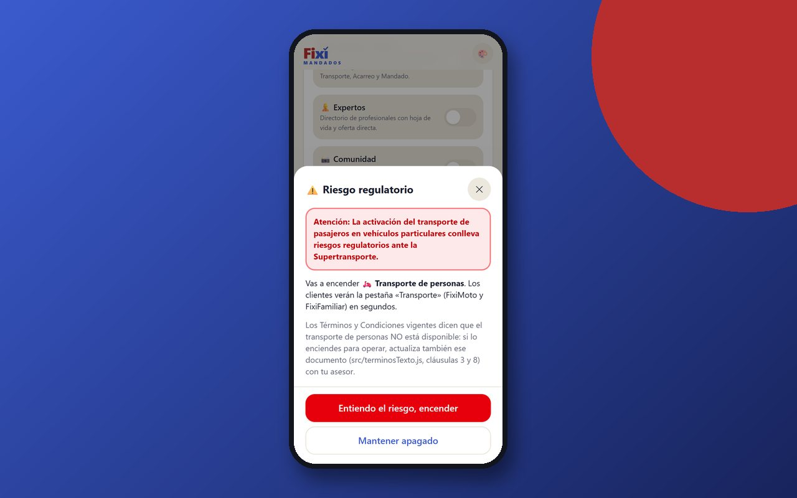
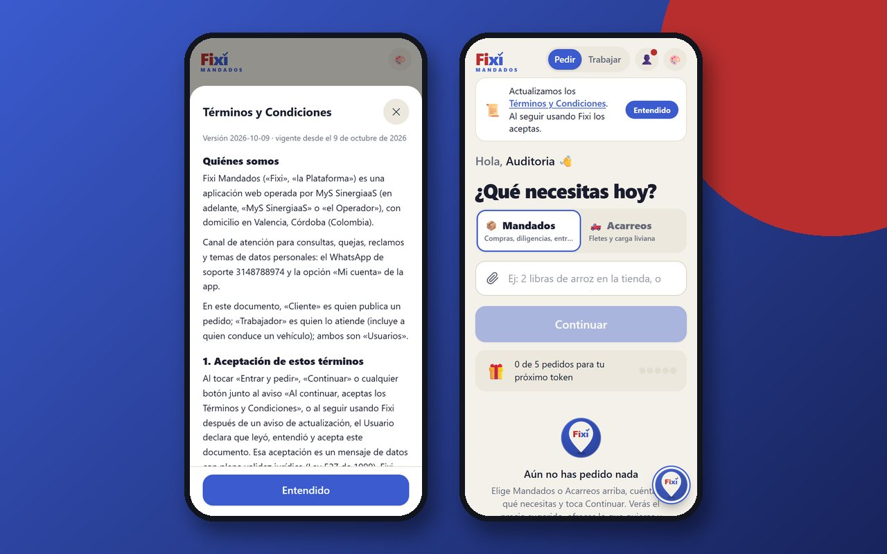

<p align="center">
  
</p>

<h1 align="center">Fixi Mandados</h1>
<p align="center"><b>Mandados y acarreos entre vecinos de un mismo municipio, con seguimiento en vivo</b><br>
Caso de éxito de <a href="https://github.com/macsaenz07">MyS SinergiaaS</a> · en producción en Valencia, Córdoba (Colombia)</p>

<p align="center">
  <a href="https://fixi-mandados-valencia.vercel.app"></a>
  
  
</p>

---

## El encargo

En un municipio pequeño, quien necesita que le traigan algo de la plaza, le hagan una diligencia
o le lleven una nevera pregunta en el barrio o en un grupo de WhatsApp: no sabe cuánto va a
costar, quién va a llegar ni si de verdad llegará. Del otro lado, mucha gente con moto,
motocarro o camioneta se entera tarde de esos trabajos, o no se entera.

El cliente pidió además poder **operar legalmente en Colombia desde el primer día**.

## Lo que entregamos

Una plataforma de economía colaborativa hiperlocal con dos modos en la misma app: **pedir** y
**trabajar**.

| Resultado | Qué significa para el usuario |
|---|---|
| **Mandados y Acarreos** | El cliente elige el servicio, cuenta qué necesita y toca Continuar. |
| **Precio sugerido o tu oferta** | Ve una tarifa de referencia y puede ofrecer otra; los trabajadores pueden contraofertar. |
| **Seguimiento en vivo** | Ve en el mapa a quien va en camino y recibe el aviso «ya llegué», aunque tenga la app cerrada. |
| **Radar que ya filtra** | El trabajador solo recibe los pedidos cercanos que puede hacer con su vehículo, y uno a la vez. |
| **Pago directo** | El cliente le paga al trabajador al terminar. La plataforma cobra una comisión prepagada solo por lo que se hace. |
| **Código de entrega** | El trabajo se cierra con un código de 4 dígitos que el cliente da cuando todo está hecho. |

## Listo para operar en Colombia

- **Términos y Condiciones propios**, visibles en el registro, en «Mi cuenta» y en un enlace
  público: plataforma de intermediación tecnológica, trabajadores independientes, responsabilidad
  sobre la carga, artículos prohibidos, prohibición de camuflar transporte de personas y tratamiento
  de datos personales (Habeas Data).
- **Aceptación sin fricción y con prueba:** sin casillas; la versión aceptada y la fecha quedan
  registradas, y quien ya tenía cuenta recibe un aviso de actualización.
- **Módulos encendibles en vivo:** el transporte de personas está desarrollado pero **apagado por
  decisión regulatoria**; el panel exige confirmar una advertencia antes de encender un módulo con
  riesgo.
- **Verificación de identidad** para quienes trabajan y registro exprés de clientes en tres datos.

## Capturas

| Pedir | Radar del trabajador | Seguimiento y entrega |
|---|---|---|
|  |  |  |

| Panel de módulos | Términos dentro de la app |
|---|---|
|  |  |

<p align="center"></p>

## Stack tecnológico aplicado

| Capa | Tecnología |
|---|---|
| Interfaz | React 19 · Vite · **Tailwind CSS 4** · diseño pensado primero para el celular · identidad Rojo & Azul con temas |
| Aplicación instalable | PWA con manifiesto, íconos propios y avisos push |
| Mapas | OpenStreetMap con Leaflet · seguimiento GPS en vivo |
| Datos en vivo | Base de datos en la nube con sincronización en tiempo real |
| Integraciones | WhatsApp directo entre cliente y trabajador · navegación GPS |
| Publicación | Vercel, verificado con pruebas automáticas |

---

## Sobre este repositorio

> **Repositorio de exhibición.** Contiene una **selección de componentes de interfaz** publicada
> para que otros desarrolladores puedan valorar la calidad de nuestro trabajo: maquetación,
> sistema de diseño, temas claro/oscuro y estilo de código.
>
> **No incluye** la lógica de negocio, la billetera, las reglas de la base de datos, el emparejamiento por vehículo, los precios
> ni las pruebas de la plataforma. Ese material es propiedad de MyS SinergiaaS y no se publica.

```
frontend/
├── index.html                  Documento base, metadatos y PWA
├── src/index.css               Sistema de diseño sobre Tailwind CSS 4 (claro / oscuro)
└── src/componentes/
    ├── ui.jsx                  Botones, avisos accionables, hojas inferiores y arrastre del asistente
    ├── Mapa.jsx                Mapa liviano del radar
    ├── Terminos.jsx            Aviso de aceptación, hoja de Términos y aviso de actualización
    └── terminosTexto.js        Texto de los Términos y Condiciones (fuente única)
```

## ¿Necesita algo así para su negocio?

Construimos plataformas de servicios, tiendas virtuales y aplicaciones de gestión a la medida.

**MyS SinergiaaS** · *Automatiza. Escala. Vende.*
🌐 [Portafolio completo](https://mac-saenz-portafolio.vercel.app) · 💬 WhatsApp +57 314 878 8974

© MyS SinergiaaS. Todos los derechos reservados. El código publicado aquí es material de
demostración y no se licencia para su reutilización.
